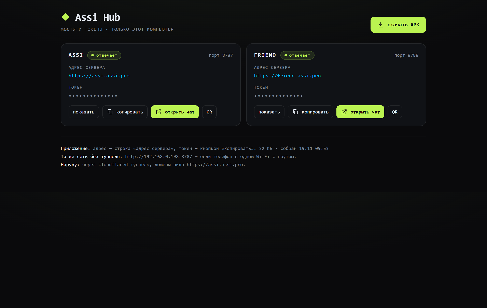

# Assi Bridge

Мост между телефоном и компьютером: телефон становится пультом для [OpenCode](https://opencode.ai) — чат с агентом, файлы и фото, голосовой ввод, управление питанием ПК.

<p align="center"></p>

## Что умеет

- **Чат** с агентом OpenCode из браузера или приложения (SSE-стриминг ответа, markdown, история сессий, переключение и создание чатов).
- **Файлы в обе стороны** — отправка с телефона агенту и **скачивание с ПК**: проводник по дискам прямо в приложении, а любой путь в ответе агента превращается в ссылку «скачать на телефон». Файл с телефона можно положить **прямо в любую папку ПК** (кнопка загрузки в проводнике), без участия агента.
- **Трей на ПК** — `phone_tray.py`: правый клик по иконке → «Отправить файл на телефон», файл сам приезжает в «Загрузки» телефона.
- **Голос** — запись в браузере, расшифровка локально через `faster-whisper` (без внешних сервисов).
- **Питание ПК** — сон, блокировка, перезагрузка, выключение, а также **Wake-on-LAN** (шлёт само приложение, когда сервер спит).
- **Сторож связи** — приложение пингует `/api/ping`; если ноут уснул, показывает «Разбудить ноут» вместо ошибки Cloudflare.
- **Хаб `/local`** — локальная страница со всеми мостами: адрес, токен, статус, QR-код, кнопка скачать APK.
- **Несколько экземпляров** — каждый со своим портом, токеном, доменом и историей (переменные окружения).

## Гайд: установка на компьютер

> Это для того, кто ставит мост на **свой** ПК. Другой человек ставит его у себя — доступ к чужому компьютеру мост не даёт.

Нужно: Windows 10/11, интернет, ~10 минут. Терминал почти не понадобится — только для варианта «одной командой».

### Шаг 0. Проверь, что стоит OpenCode

```powershell
opencode --version
```

Если команда не найдена — поставь OpenCode с https://opencode.ai и **один раз залогинься** в нём (выбери провайдера/модель). Мост сам не содержит модели: он поднимает `opencode serve` и говорит с ним.

Агент должен уметь ходить в свои файлы — проверь, что OpenCode открывается и отвечает на любой вопрос. Если он не работает без моста, мост тоже не заработает.

### Шаг 1. Скачай мост

Вариант А — одна команда в PowerShell (скачивает zip в `%USERPROFILE%\assi-bridge`, распаковывает и запускает установку):

```powershell
irm https://raw.githubusercontent.com/F0RN1/assi-bridge/main/bootstrap.ps1 | iex
```

Вариант Б — вручную:

```powershell
cd $env:USERPROFILE
git clone https://github.com/F0RN1/assi-bridge
cd assi-bridge
```

или скачай [zip](https://github.com/F0RN1/assi-bridge/archive/refs/heads/main.zip) и распакуй, например в `%USERPROFILE%\assi-bridge`.

> Папку не обязательно держать именно там, но путь без пробелов и кириллицы избавит от половины проблем.

### Шаг 2. Запусти установку

Двойной клик по **`install.cmd`** (или в консоли `powershell -ExecutionPolicy Bypass -File install.cmd`).

Визард (`setup.ps1`) по шагам:

| Что проверяет | Если нет |
|---|---|
| Python 3.10+ | предлагает `winget install Python.Python.3.12` |
| `cloudflared` (туннель наружу) | предлагает `winget install Cloudflare.cloudflared` |
| `bridge.json` (уже установлен?) | если есть — просто запускает сервер, ничего не затирает |
| свободный порт | берёт первый свободный начиная с `8787` |

Дальше спрашивает **имя компьютера**:

- 2–8 символов, только латиница и цифры — `forni`, `home1`, `pc2`;
- это имя видно в приложении и в адресе `/local`, менять потом можно в `bridge.json`;
- неправильный ввод — попросит ещё раз, без ругани и падений.

Затем генерирует токен (32 символа), пишет `bridge.json`, поднимает мост + туннель + иконку в трее, кладёт ярлык в автозагрузку и печатает:

```
================ Assi готов ================
имя:        forni
локально:   http://127.0.0.1:8787
снаружи:    https://quiet-river-1234.trycloudflare.com
код подключения (вставь в приложение):
https://quiet-river-1234.trycloudflare.com/?token=AbC...xyz
```

(реальные значения, конечно, другие)

### Шаг 3. Забери код подключения

Код — это одна строка вида `https://адрес/?token=…`. Он лежит в трёх местах:

- в окне установки (и уже скопирован в буфер обмена);
- в файле **`connect.txt`** рядом с `app.py`;
- на локальной странице **http://127.0.0.1:8787/local** — кнопка «скопировать код» и QR-код.

Перекинь его себе на телефон любым способом (Telegram «Избранное», заметки, QR с экрана).

> **Токен = полный доступ к компьютеру** через мост: файлы, чат с агентом, память, питание. Никому не пересылай. Если утёк — удали `token` из `bridge.json`, перезапусти `.\assi.ps1 on`, получи новый код.

### Шаг 4. Убедись, что сервер живой

```powershell
.\assi.ps1 status
# мост: работает | туннель: есть | трей: есть

Invoke-WebRequest http://127.0.0.1:8787/api/ping -UseBasicParsing
# {"ok":true,"owner":true,"instance":"assi","name":"forni"}
```

Если `мост: стоит` — `.\assi.ps1 on` и подожди ~10 секунд (первый запуск `opencode serve` небыстрый).

## Гайд: подключение телефона

**1. Поставь приложение.** Свежий APK отдаёт сам мост: открой на телефоне `http://<ip-компьютера>:8787/apk` из той же Wi-Fi, либо скачай `http://127.0.0.1:8787/apk` на ПК и перекинь файл. Android спросит про «неизвестный источник» — разреши для файлового менеджера/браузера.

**2. Вставь код подключения.** Открой приложение → экран «Код подключения» → вставь строку целиком (`https://адрес/?token=…`) → «Подключиться». Приложение само выделит адрес и токен; `https://` можно не писать — добавит.

**3. Проверь связь.** Должен открыться чат с историей сессий. Если написало «Сервер не отвечает» — см. таблицу ниже.

**4. Что есть в чате:**

- поле ввода: пусто — кнопка работает как **микрофон** (зажать → говоришь → отпустил → текст распознан), есть текст или файл — та же кнопка **отправляет**;
- скрепка — файл агенту;
- папка в шапке — проводник ПК: скачать файл на телефон, залить файл с телефона в любую папку ПК;
- три точки — сессии, питание ПК, **«Остановить сервер»**.

Адрес и токен приложение помнит: при следующем запуске сразу открывается чат.

## Если что-то не так

| Симптом | Причина | Что делать |
|---|---|---|
| `install.cmd` закрывается мгновенно | ошибка в PowerShell, окно не удержалось | запусти `powershell -ExecutionPolicy Bypass -File setup.ps1` и прочитай текст |
| «Python не найден» | нет Python или он не в PATH | `winget install Python.Python.3.12`, затем заново `install.cmd` |
| Мост не стартует, в `bridge.err.log` порт занят | на 8787 висит старый процесс | `.\assi.ps1 off`, затем `on`; вручную — `netstat -ano \| findstr :8787` |
| Туннель не поднялся | `cloudflared` не установлен или нет интернета | `winget install Cloudflare.cloudflared`, `.\assi.ps1 on` |
| `trycloudflare.com` не открывается | быстрый туннель живёт только пока запущен процесс | не закрывай `cloudflared`, для постоянного адреса — именной туннель (ниже) |
| Приложение: «Сервер не отвечает» | мост выключен / ноут уснул / сменился адрес туннеля | `.\assi.ps1 status`; если адрес новый — вставь новый код подключения |
| Запросы висят по 30 секунд | QUIC-туннель режется провайдером | в `config.yml` добавь `protocol: http2` и `edge-ip-version: "4"` |
| Кнопки файлов/питания исчезли | это гостевой экземпляр (не `assi`) | так и задумано: к железу доступ только у владельца |
| Голос не пишет | страница открыта по `http://`, а не `https://` | микрофон в WebView разрешён только на https — используй туннель |

Логи: `bridge.err.log` (мост), `tunnel.log` (туннель), `gate.log` (спящий порт), `client.log` (ошибки интерфейса).

## Обновление и удаление

```powershell
# обновить
cd $env:USERPROFILE\assi-bridge
git pull
.\assi.ps1 off
.\venv\Scripts\python.exe -m pip install -r requirements.txt
.\assi.ps1 on
```

Удаление: `.\assi.ps1 off`, затем удали папку и ярлык `Assi Bridge` из автозагрузки (`Win+R` → `shell:startup`). `bridge.json` содержит токен — удаляй вместе с папкой.

## Включение и выключение сервера

С компьютера — одной кнопкой:

```powershell
.\assi.ps1 on      # поднять мост, туннель и иконку в трее
.\assi.ps1 off     # остановить всё, включая «спящий порт»
.\assi.ps1 pause   # остановить только мост (порт остаётся — можно включить с телефона)
.\assi.ps1 resume  # поднять мост обратно после pause
.\assi.ps1 toggle  # переключить (этот же вызов у run.cmd и ярлыка «Assi»)
.\assi.ps1 status  # что запущено
```

`run.cmd` — тот же toggle двойным кликом; `install.cmd` дополнительно кладёт ярлык в автозагрузку.

С телефона — только владелец:

- меню чата (три точки) → **«Остановить сервер»**: мост гаснет, но `wake_gate.py` продолжает держать порт и туннель, поэтому приложение не теряет связь;
- после остановки приложение показывает **«Сервер выключен»** с кнопкой «Включить сервер» — она шлёт токен на тот же адрес, и мост поднимается обратно (~15 секунд).
- у гостевых экземпляров (не `assi`) эти кнопки не работают: `403`, сервером управляет только владелец.

## Доступ снаружи

Мост слушает локальный порт и наружу сам не смотрит. Два варианта:

**Быстрый (по умолчанию).** Если `%USERPROFILE%\.cloudflared\config.yml` нет, `assi.ps1` поднимает временный туннель `cloudflared tunnel --url http://127.0.0.1:8787` и сам подставляет полученный `https://…trycloudflare.com` в код подключения. Адрес живёт, пока жив туннель, — для «попробовать» хватает, для постоянки нужен именной.

**Именной (постоянный адрес).** Свой домен на Cloudflare:

```yaml
# %USERPROFILE%\.cloudflared\config.yml
tunnel: <tunnel-id>
credentials-file: C:\Users\<user>\.cloudflared\<tunnel-id>.json
protocol: http2
edge-ip-version: "4"

ingress:
  - hostname: assi.example.com
    service: http://127.0.0.1:8787
  - service: http_status:404
```

`protocol: http2` + IPv4 — не косметика: на QUIC (UDP) туннель у части провайдеров рвётся и запросы висят по 30 секунд.

## Второй экземпляр (для друга, теста)

```powershell
powershell -ExecutionPolicy Bypass -File start-friend.ps1
```

| Переменная | По умолчанию | Что задаёт |
|---|---|---|
| `ASSI_INSTANCE` | `assi` | имя экземпляра: `bridge-<имя>.json`, `client-<имя>.log`, `~/Inbox/<имя>` |
| `ASSI_PORT` | `8787` | порт HTTP |
| `ASSI_OPENCODE_PORT` | `8790` | порт `opencode serve` для этого экземпляра |
| `ASSI_PUBLIC_URL` | `https://assi.assi.pro` | адрес, который показывается на `/local` |

У каждого экземпляра свой токен, своя сессия и своя папка входящих — чаты не пересекаются.

**Гостевой режим.** Всё, что трогает компьютер, доступно только экземпляру `assi` (владелец машины): проводник, загрузка в папки, очередь файлов, питание и Wake-on-LAN. Любой другой экземпляр (`friend`, `slava`, …) получает только чат — эти ручки отдают `403`, а кнопки в интерфейсе скрыты. Если мост нужен другу — он ставит его **на своей машине**, а не на твоей.

## API

| Метод | Путь | Назначение |
|---|---|---|
| `GET` | `/api/ping` | проверка живости (без токена) |
| `GET` | `/api/history` | история текущей сессии |
| `POST` | `/api/chat` | отправить сообщение агенту |
| `GET` | `/api/stream?t=<token>` | SSE: дельты текста и завершение |
| `GET` | `/api/sessions` | список сессий, `POST /api/session/new`, `/api/session/select` |
| `POST` | `/api/upload` | файл с телефона → локальный путь |
| `GET` | `/api/fs/list?path=` | проводник: диски, папки, файлы с размерами |
| `GET` | `/api/fs/download?path=&t=` | отдать файл с ПК на телефон |
| `POST` | `/api/fs/upload?path=` | положить файл с телефона в выбранную папку ПК |
| `POST` | `/api/share` | очередь «ПК → телефон» (файл кладёт трей) |
| `GET` | `/api/share`, `/api/share/{id}`, `POST /api/share/{id}/ack` | забрать и подтвердить файл из очереди |
| `POST` | `/api/transcribe` | аудио → текст (faster-whisper) |
| `POST` | `/api/power` | `lock` / `sleep` / `reboot` / `shutdown` |
| `GET` | `/api/server` | сведения о сервере: имя, публичный адрес, порт |
| `POST` | `/api/server` | `{"action":"stop"}` — остановить мост с телефона (только владелец) |
| `GET` | `/api/wol-info` | MAC и broadcast-адреса для Wake-on-LAN |
| `GET` | `/apk` | свежий APK приложения |
| `GET` | `/local` | хаб с токенами — **только с localhost** |

Авторизация — заголовок `X-Bridge-Token` (или `?t=` для SSE).

## Безопасность

- Токен — единственный ключ ко всему: файлы, сессии, память агента, питание ПК. Никому не передавайте.
- `/local` отдаётся только на `127.0.0.1` — снаружи 404.
- `bridge.json`, `bridge-friend.json`, логи и `.venv` в `.gitignore`.
- Всё, что даёт доступ к железу (проводник, папки, очередь, питание, WOL), работает только у экземпляра-владельца `assi`; гостевые экземпляры — только чат.

## Структура

```
app.py                  FastAPI: OpenCode, чат, SSE, загрузки, питание, WOL, /local
wake_gate.py            «спящий порт»: сервер выключен, но телефон может его включить
static/index.html       интерфейс чата (терминальная тема)
static/sw.js            service worker: оболочка из кэша, /api — всегда в сеть
static/manifest.webmanifest  PWA-манифест
install.cmd             установка в один клик (зовёт setup.ps1 -Autostart)
bootstrap.ps1           скачать репозиторий и запустить install.cmd (одна команда)
setup.ps1               визард: Python, venv, зависимости, cloudflared, имя, токен, код подключения
install-assi.ps1        обёртка над setup.ps1 (совместимость)
assi.ps1                сервер одной кнопкой: on | off | toggle | pause | resume | status
run.cmd                 toggle двойным кликом
start-assi.ps1          автозапуск (assi.ps1 on)
stop-assi.ps1           остановка (assi.ps1 off)
start-friend.ps1        второй экземпляр (8788), гостевой режим
start-tray.ps1          иконка в трее: отправить файл на телефон
phone_tray.py           сам трей (pystray, requirements-tray.txt)
requirements.txt        зависимости
```

Приложение: [F0RN1/assi-app](https://github.com/F0RN1/assi-app).

## Лицензия

MIT
